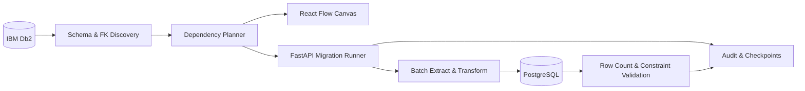

# Relational Database Migration Platform

**IBM Db2 → PostgreSQL | FastAPI · React · SQLAlchemy · Docker**

A visual, dependency-aware migration tool that discovers relational schemas, builds execution plans, migrates data in batches, and validates the target database.

> **Development status:** Proof of concept. Table/data migration and row-count validation have been exercised. Full replication of primary, unique, and foreign-key constraints is still in progress. The last verified PostgreSQL target had **0 foreign keys** versus **22 in the Db2 MIGTEST source**.

## System Architecture



## Quick Start

**Prerequisites:** Docker Desktop, Python, Node.js/npm, a configured Db2 source, and backend dependencies.

Start your existing database containers in PowerShell:

```powershell
docker start migration-db2
docker start migration-target-db
docker ps
```

Start the backend:

```powershell
cd backend
.\.venv\Scripts\Activate.ps1
pip install -r requirements.txt
python -m pytest -q
uvicorn app.main:app --reload
```

Start the frontend in another terminal:

```powershell
cd frontend
npm install
npm run dev
```

| Service | Local address |
|---|---|
| Frontend | http://localhost:5173 |
| FastAPI | http://localhost:8000 |
| API docs | http://localhost:8000/docs |
| PostgreSQL target | localhost:5434 (database protocol, not HTTP) |
| Db2 source | Check Docker port mapping; often localhost:50000 |

Use environment variables for credentials; **never commit passwords**. Confirm the actual router prefix and request schemas in `/docs`.

## Core API

| Method | Endpoint | Purpose |
|---|---|---|
| POST | `/migrations` | Create a migration job |
| GET | `/migrations/{job_id}` | Read job status |
| POST | `/migrations/plan` | Generate a table plan |
| POST | `/migrations/plan/dependencies` | Discover FK execution order |
| POST | `/migrations/run` | Start a background migration |

These paths assume the migration router is mounted at `/migrations`.

## MIGTEST Regression Benchmark

**Source baseline:** 13 tables, 68 rows, 22 foreign keys. Important cases include the `CATEGORIES` self-reference and the composite `ORDER_ITEMS → INVENTORY` foreign key.

| Table | Rows | Table | Rows |
|---|---:|---|---:|
| ADDRESSES | 6 | CATEGORIES | 6 |
| CUSTOMERS | 5 | CUSTOMER_ADDRESSES | 6 |
| INVENTORY | 7 | ORDERS | 5 |
| ORDER_ITEMS | 8 | PAYMENTS | 5 |
| PRODUCTS | 5 | REVIEWS | 5 |
| SHIPMENTS | 5 | SUPPLIERS | 3 |
| WAREHOUSES | 2 | **Total** | **68** |

Verify the target:

```sql
SELECT COUNT(*) AS table_count
FROM information_schema.tables
WHERE table_schema = 'MIGTEST' AND table_type = 'BASE TABLE';

SELECT COUNT(*) AS fk_count
FROM information_schema.table_constraints
WHERE table_schema = 'MIGTEST' AND constraint_type = 'FOREIGN KEY';

SELECT conname, pg_get_constraintdef(oid)
FROM pg_constraint
WHERE contype = 'f' AND connamespace = 'MIGTEST'::regnamespace;
```

**Acceptance criteria:** All 13 tables, matching per-table counts, correct PK/unique constraints, and 22 correctly mapped foreign keys. Do not treat a successful row-count check as proof of relational integrity.

## Error Handling and Recovery

| Failure | Response / engineering requirement |
|---|---|
| Unsupported Db2 type | Report table/type, add mapping and regression test |
| Existing target table missing columns | Detect schema drift; don't rely on `CREATE TABLE IF NOT EXISTS` |
| Network interruption | Record error; add bounded retry/backoff for transient failures |
| Partial batch failure | Use transactional writes and idempotent resume semantics |
| FK or PK creation failure | Mark relational validation failed, preserve diagnostic SQL |
| Source/target row-count mismatch | Mark validation failure and investigate |

**Current state:** Audit events and batch checkpoints exist. Fully safe automatic resume, bounded retries, and exactly-once semantics are future work—not current guarantees.

## Research Roadmap

- [x] Db2 table/column discovery and type mapping
- [x] Dependency planning and React Flow visualization
- [x] Batch migration, audit events, and row-count validation
- [ ] Full PK, unique, composite FK, and self-referencing FK migration
- [ ] Source/target schema diff and drift detection
- [ ] Transactionally safe restart and bounded retries
- [ ] Referential integrity and checksum-based data validation
- [ ] Dependency-level parallel scheduling
- [ ] Reproducible benchmarks for throughput, memory, and recovery
- [ ] Authentication, secure secret storage, and production worker queue

**Research direction:** Preserving relational semantics across heterogeneous databases while balancing correctness, recoverability, observability, and throughput.

---

## Implementation Notes

The existing project documentation provides deeper information about the migration modules, type mapping, checkpoint handling, and validation.

## Repository Structure

```text
mig/
├── backend/
│   ├── app/
│   │   ├── api/migrations.py
│   │   ├── connectors/
│   │   ├── discovery/dependencies.py
│   │   ├── migration/
│   │   │   ├── runner.py
│   │   │   ├── executor.py
│   │   │   ├── loader.py
│   │   │   ├── transformer.py
│   │   │   └── ddl_live.py
│   │   ├── models/migration.py
│   │   ├── validation/
│   │   └── main.py
│   └── tests/
├── frontend/
│   └── src/components/migration/SchemaCanvas.tsx
└── README.md
```

## Security and Contributing

Keep `.env`, credentials, database dumps, and connection URLs with passwords out of Git. Reproduce bugs using anonymized schemas and include test output and audit events. Add a `LICENSE` file before advertising an open-source license.
